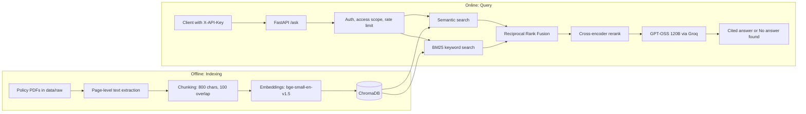

# Insurance Policy RAG Assistant

A Retrieval-Augmented Generation (RAG) API that answers questions about health insurance policy documents with **grounded, source-cited responses**. It combines semantic and keyword retrieval, fuses the results, re-ranks them with a cross-encoder, and instructs the LLM to answer only from the retrieved passages, or reply *"No answer found in the provided policy documents."*

The service adds API-key authentication, per-user document access control, rate limiting, and structured logging around the RAG core.

---

## Table of Contents

- [Problem Statement](#problem-statement)
- [Key Features](#key-features)
- [Architecture](#architecture)
- [RAG Pipeline](#rag-pipeline)
- [Tech Stack](#tech-stack)
- [Project Structure](#project-structure)
- [Getting Started](#getting-started)
- [Source Documents](#source-documents)
- [API Reference](#api-reference)
- [Authentication & Access Control](#authentication--access-control)
- [Verified Results](#verified-results)
- [Evaluation](#evaluation)
- [Design Decisions](#design-decisions)
- [Limitations](#limitations)
- [Future Improvements](#future-improvements)
- [Screenshots](#screenshots)
- [Security Notes](#security-notes)
- [License](#license)

---

## Problem Statement

Insurance policy wordings are long, dense, and often similar across insurers. Checking whether something (for example, dental treatment) is covered means searching through many pages of legal text. This project lets a user ask a plain-English question and get a short answer with file and page citations, and it declines to answer when the documents do not support one.

## Key Features

- **Grounded answers with citations**: sources include file name, page, and snippet
- **Hybrid retrieval**: semantic search + BM25 keyword search, merged with Reciprocal Rank Fusion (RRF)
- **Cross-encoder reranking** for better passage ordering
- **No-answer fallback** when retrieved context does not contain the answer
- **API-key authentication** with SHA-256 hashed keys and constant-time comparison
- **Per-user document access control**, applied during retrieval
- **Sliding-window rate limiting** (in-memory)
- **Request IDs and structured JSON logging**; raw questions are not logged
- **FastAPI REST API** with Swagger docs and a persistent ChromaDB vector store

## Architecture



## RAG Pipeline

**PDF → chunks → embeddings → Chroma → hybrid retrieval → RRF → reranking → LLM → cited answer**

1. **Ingestion**: all PDFs in `data/raw/` are read page by page, preserving source filename, page number, and text.
2. **Chunking**: text is split into 800-character chunks with 100-character overlap; very small chunks are discarded.
3. **Embeddings**: each chunk is embedded with `BAAI/bge-small-en-v1.5`; embeddings are normalized and stored in ChromaDB with source and page metadata.
4. **Hybrid retrieval**: a question runs through semantic search (vector similarity) and BM25 keyword search. BM25 helps with exact policy terms that embeddings can blur.
5. **Reciprocal Rank Fusion**: the two ranked lists are merged using the score `1 / (60 + rank + 1)` to form a hybrid candidate set.
6. **Reranking**: `cross-encoder/ms-marco-MiniLM-L-6-v2` scores the question against each candidate, and the top passages are kept.
7. **Generation**: the selected passages are numbered and passed to GPT-OSS 120B (via Groq). The model is instructed to use only the supplied context, cite passages as `[1]`, `[2]`, and return the no-answer message when the context is insufficient.
8. **Response**: the API returns the answer plus source file, page, and snippet metadata corresponding to the retrieved/cited passages.

## Tech Stack

| Component | Technology |
| --- | --- |
| Language | Python |
| API | FastAPI, Uvicorn |
| LLM | GPT-OSS 120B via Groq API |
| Embeddings | `BAAI/bge-small-en-v1.5` |
| Vector database | ChromaDB (persistent, local) |
| Keyword retrieval | BM25 (`rank-bm25`) |
| Reranking | `cross-encoder/ms-marco-MiniLM-L-6-v2` |
| PDF processing | PyPDF |
| Authentication | API keys + SHA-256 hashing |
| Logging | Structured JSON logging |
| Testing / CI | pytest, CI workflow |
| Packaging | Docker (optional) |

## Project Structure

```text
Insurance-Policy-RAG-Assistant/
├── src/
│   ├── api.py              # FastAPI app, routes, middleware
│   ├── config.py           # Configuration
│   ├── ingest.py           # PDF extraction, chunking, embedding, Chroma insert
│   ├── retriever.py        # Semantic, BM25, hybrid (RRF), rerank
│   ├── generator.py        # Grounded prompt, citations, no-answer fallback
│   ├── security.py         # Hashed API-key store, rate limiter
│   └── observability.py    # JSON log formatter
├── scripts/
│   └── bootstrap_users.py  # Creates demo users and keys
├── config/
│   └── users.json          # Generated user config (hashed keys, access scopes)
├── data/
│   └── raw/                # Policy PDFs (not committed)
├── eval/                   # Evaluation scripts
├── tests/                  # Unit tests
├── chroma_db/              # Generated vector store
├── Design.md               # Design notes and trade-offs
├── Dockerfile
├── requirements.txt
└── .env                    # Local secrets (not committed)
```

## Getting Started

### Prerequisites

- Python 3.11
- A Groq API key from [console.groq.com](https://console.groq.com)

### 1. Clone and install

```bash
git clone https://github.com/<your-username>/Insurance-Policy-RAG-Assistant.git
cd Insurance-Policy-RAG-Assistant

# Windows (PowerShell)
python -m venv .venv
.venv\Scripts\activate

# Linux / macOS
python3 -m venv .venv
source .venv/bin/activate

pip install -r requirements.txt
```

### 2. Configure `.env`

```env
GROQ_API_KEY=your_groq_api_key
```

Do not commit `.env` or share the key.

### 3. Add the policy PDFs

Download the four documents from the [Source Documents](#source-documents) section and place them in `data/raw/`:

```bash
mkdir -p data/raw      # PowerShell: mkdir data\raw
```

### 4. Build the index

```bash
python -m src.ingest
```

### 5. Create demo users

```bash
python scripts/bootstrap_users.py
# To regenerate users if config/users.json already exists:
python scripts/bootstrap_users.py --force
```

Plaintext demo keys are written to `.demo_keys.txt`. **Do not commit this file.**

### 6. Run the API

```bash
uvicorn src.api:app --reload
```

Open Swagger UI at <http://127.0.0.1:8000/docs>.

### Optional: run tests

```bash
pytest
```

Docker support is included in the repository through the `Dockerfile`.

## Source Documents

The four policy documents are **not redistributed in this repository**. Download them from the public sources below and place them in `data/raw/`.

| # | Insurer / Product | Source | Expected filename |
| --- | --- | --- | --- |
| 1 | Universal Sompo, A Plus Health | [Policy wording](https://www.universalsompo.com/assets/file/a-plus-health-insurance/a-plus-health-insurance-policy-wording.pdf) | `a-plus-health-insurance-policy-wording.pdf` |
| 2 | IFFCO Tokio, Health Protector | [Policy wording](https://www.iffcotokio.co.in/content/dam/iffcotokio/iffco-pdf/sites/default/files/pdf/Health%20Protector%20Policy%20Wording.pdf) | `Health Protector Policy Wording.pdf` |
| 3 | United India, Individual Health Insurance (prospectus) | [Prospectus](https://uiic.co.in/web/sites/default/files/Policy-Document/20240325_Prospectus_IHIP.pdf) | `20240325_Prospectus_IHIP.pdf` |
| 4 | Religare, Health Care Advantage | [Policy wording](https://www.eindiainsurance.com/brochure/religare-health-care-advantage-policy-wordings.pdf) | `religare-health-care-advantage-policy-wordings.pdf` |

Keep the original filenames, since citations and per-user access scopes reference them.

## API Reference

| Endpoint | Auth | Description |
| --- | --- | --- |
| `GET /health` | No | Liveness check |
| `GET /ready` | No | Reports ready once the retriever and user store are initialized |
| `POST /ask` | `X-API-Key` | Ask a question; returns a cited answer |

### Example request

```bash
curl -X POST http://127.0.0.1:8000/ask \
  -H "Content-Type: application/json" \
  -H "X-API-Key: <YOUR_DEMO_API_KEY>" \
  -d '{"question": "Is dental treatment covered?"}'
```

### Example response (illustrative)

```json
{
  "answer": "<grounded answer with [1] citation>",
  "sources": [
    {
      "file": "Health Protector Policy Wording.pdf",
      "page": 12,
      "snippet": "..."
    }
  ],
  "user": "admin",
  "latency_ms": 2052,
  "request_id": "..."
}
```

Actual answers and latency depend on the indexed documents and runtime conditions.

### Out-of-scope question

A question unrelated to the documents (for example, "What is the capital of France?") returns:

```text
No answer found in the provided policy documents.
```

with no sources.

## Authentication & Access Control

Requests to `/ask` use an `X-API-Key` header. Keys are randomly generated, stored only as **SHA-256 hashes** in `config/users.json`, and compared in constant time. Plaintext demo keys exist only in the locally generated `.demo_keys.txt`.

Each user has a document access scope and a rate limit. The demo configuration includes:

| User | Document access | Rate limit |
| --- | --- | --- |
| `admin` | All documents | 30 requests/min |
| `alice` | Selected documents | 20 requests/min |
| `bob` | Selected documents | 20 requests/min |
| `guest` | No documents | 5 requests/min |

Access filtering is applied **inside retrieval** (before ranking), so documents a user cannot access never reach the LLM prompt. Rate limiting uses an in-memory sliding window and is process-local.

**Observability:** logs are structured JSON with request IDs, retrieved-chunk counts, returned sources, and retrieval/generation latency. Raw user questions are not logged.

## Verified Results

Verified on a local run with the four policy documents:

| Check | Result |
| --- | --- |
| PDFs ingested | 4 |
| Pages processed | 161 |
| Chunks indexed | 777 |
| `GET /health` | 200 OK |
| `GET /ready` | 200 OK |
| Dental-treatment question | Grounded answer citing `Health Protector Policy Wording.pdf`, page 12 |
| Out-of-domain question | Correct "No answer found" response with no sources |

## Evaluation

The `eval/` directory contains scripts for generating evaluation questions from indexed chunks (LLM-generated, then spot-checked) and for measuring retrieval hit rate, ranking quality, and answer groundedness across retrieval modes. Typical entry points:

```bash
python -m eval.generate_questions
python -m eval.hit_rate
python -m eval.judge
```

This README intentionally reports **no benchmark numbers**; the only results claimed are the verification checks above. Because the question set is generated from the same chunks it tests, and groundedness is LLM-judged, any scores should be treated as indicative rather than rigorous.

## Design Decisions

- **Hybrid retrieval**: semantic search captures meaning; BM25 captures exact policy terms (clause names, "waiting period").
- **Reranking**: a cross-encoder rescoring step improves final ordering at the cost of extra CPU latency.
- **Filter before ranking**: access control is enforced during retrieval rather than hiding results afterward.
- **No-answer fallback**: policy answers are wording-sensitive, so the system avoids falling back on general model knowledge.
- **Privacy-aware logging**: logs record counts and lengths rather than customer question text.

See [`Design.md`](Design.md) for more detail.

## Limitations

- The rate limiter is process-local, so it does not suit multi-replica deployments.
- ChromaDB runs embedded locally rather than as a managed vector database.
- No OCR, so image-only PDFs are not supported.
- No incremental re-ingestion; changing documents means re-running ingestion.
- API keys are static credentials, not a full identity-management system.
- The evaluation set is LLM-generated and only spot-checked.
- Answers are informational and not a substitute for official policy terms or professional advice.

## Future Improvements

- Incremental ingestion and OCR for scanned policies
- Stronger, human-reviewed evaluation datasets and quality metrics
- Distributed rate limiting (e.g., Redis)
- Production authentication with key rotation/expiry or OAuth/JWT
- Managed vector database and richer document metadata filtering
- Deployment with monitoring and CI/CD

## Security Notes

- **Never commit** `.env`, `.demo_keys.txt`, or a `config/users.json` that contains local credentials; keep them in `.gitignore`. Treat `chroma_db/` as generated data and avoid committing it.
- `.demo_keys.txt` holds **plaintext demo keys**. Use them for local testing only, store them securely, and regenerate them with `--force` if exposed.
- Use placeholders like `<YOUR_DEMO_API_KEY>` in documentation, screenshots, and shell history.
- Rotate your Groq API key if it is ever exposed; removing it in a later commit does not revoke it.
- Only key hashes are stored in the user configuration, and raw questions are excluded from request logs.

## License

Released under the [MIT License](LICENSE).

